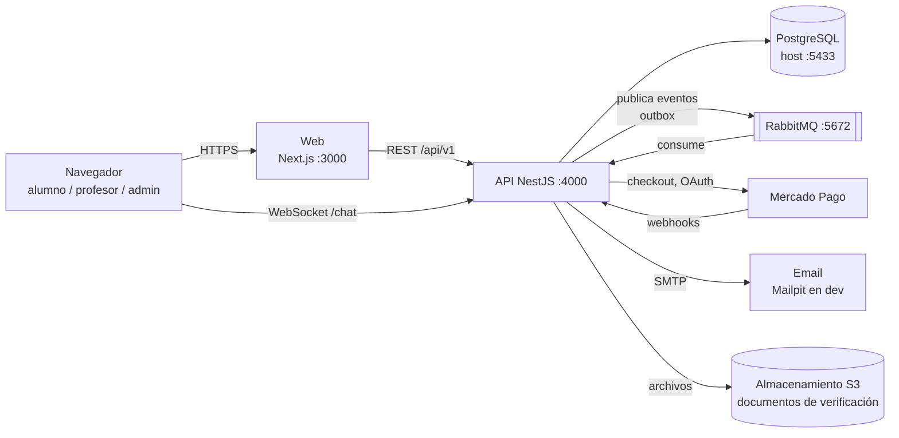

# Arquitectura de EstudioYA

> Documento vivo. Se actualiza en el mismo PR que cambia endpoints, puertos, contratos o reglas.
> Última actualización: 2026-11-17 · Leyenda de estado: ⬜ planificado · 🟨 en desarrollo · ✅ implementado

## Índice

1. [Visión general](#1-visión-general)
2. [Tecnologías](#2-tecnologías)
3. [Puertos y servicios](#3-puertos-y-servicios)
4. [Módulos del backend](#4-módulos-del-backend)
5. [Reglas de negocio](#5-reglas-de-negocio)
6. [Reglas de contrato de la API](#6-reglas-de-contrato-de-la-api)
7. [Endpoints REST](#7-endpoints-rest)
8. [Chat en tiempo real (WebSocket)](#8-chat-en-tiempo-real-websocket)
9. [Mensajería con RabbitMQ](#9-mensajería-con-rabbitmq)
10. [Variables de entorno](#10-variables-de-entorno)
11. [Seguridad](#11-seguridad)
12. [Decisiones y riesgos abiertos](#12-decisiones-y-riesgos-abiertos)

---

## 1. Visión general

Monolito modular ([ADR 0001](adr/0001-arquitectura-y-stack.md)): una web Next.js, una API NestJS y una base PostgreSQL, más RabbitMQ para trabajo asíncrono.



**Un solo proceso, varios roles:** la API también corre los *consumers* de RabbitMQ y el publicador del outbox. Si el volumen lo exige, se pueden separar en un proceso `worker` con el mismo código.

## 2. Tecnologías

| Capa | Tecnología | Versión | Notas |
|---|---|---|---|
| Runtime | Node.js | 22 LTS | `.nvmrc` |
| Backend | NestJS + TypeScript | Nest 11 | Módulos, DI, guards, WebSocket gateway |
| ORM | Prisma | 6 | Migraciones + SQL crudo para restricciones |
| Validación | Zod | 3 | Schemas compartidos en `packages/shared` |
| Frontend | Next.js + React + TypeScript | Next 15 / React 19 | SSR para páginas públicas (SEO de profesores) |
| Base de datos | PostgreSQL | 16 | Extensión `btree_gist` |
| Mensajería | RabbitMQ | 3.13 | Local en Docker |
| Pagos | Mercado Pago Marketplace | — | Split de pagos, OAuth de vendedores |
| Email | SMTP (Mailpit en dev; Resend o SES en prod) | — | |
| Archivos | S3-compatible (Cloudflare R2 previsto) | — | Bucket **privado** |
| Tiempo real | Socket.IO sobre el gateway de NestJS | — | |
| CI | GitHub Actions | — | `.github/workflows/ci.yml` |

Pendientes de elegir cuando haga falta (no bloquean el MVP): librería de UI, estado de datos del cliente (se propone TanStack Query), framework de tests (Jest o Vitest + Playwright), logger (pino) y Sentry.

## 3. Puertos y servicios

| Servicio | Puerto | Protocolo | Entorno | Notas |
|---|---|---|---|---|
| Web (Next.js) | **3000** | HTTP | local | `npm run dev:web` |
| API (NestJS) | **4000** | HTTP + WebSocket | local | Prefijo `/api/v1`; chat en namespace `/chat` |
| PostgreSQL | **5433** (host) → 5432 (contenedor) | TCP | Docker | usuario/clave en `.env`; el puerto del host se cambia con `POSTGRES_PORT` |
| RabbitMQ (AMQP) | **5672** | AMQP | Docker | |
| RabbitMQ (panel) | **15672** | HTTP | Docker | http://localhost:15672 |
| Mailpit (SMTP) | **1025** | SMTP | Docker | |
| Mailpit (UI) | **8025** | HTTP | Docker | bandeja de emails de prueba |

Si un puerto está ocupado, cambiarlo en `.env` y en `docker-compose.yml`, y **actualizar esta tabla**.

> **Por qué PostgreSQL usa 5433 en el host:** en Windows con Docker Desktop (WSL), el proceso `wslrelay.exe` puede retener el 5432 sin reenviarlo al contenedor, y Prisma falla con `P1001: Can't reach database server`. Usar 5433 y `127.0.0.1` (en vez de `localhost`) lo evita. Ver [solución de problemas](../README.md#solución-de-problemas).

## 4. Módulos del backend

Cada módulo vive en `apps/api/src/modules/<nombre>/` con su controller, service, DTOs y tests.

| Módulo | Responsabilidad | Estado |
|---|---|---|
| `health` | Chequeo de salud | ✅ |
| `auth` | Registro, login, logout, refresh, Google, guards y roles | ⬜ |
| `users` | Perfil del usuario | ⬜ |
| `catalog` | Facultades y materias | ⬜ |
| `teachers` | Perfiles, materias y precios, búsqueda y ranking, solicitudes de alta | ⬜ |
| `availability` | Slots de disponibilidad del profesor | ⬜ |
| `bookings` | Reservas, cupos, cancelaciones, vencimiento de holds | ⬜ |
| `payments` | Checkout, OAuth de Mercado Pago, webhooks, reembolsos, payouts | ⬜ |
| `chat` | Conversaciones, mensajes, moderación, reportes | ⬜ |
| `reviews` | Reseñas y recálculo de puntaje | ⬜ |
| `support` | FAQ y tickets de contacto | ⬜ |
| `admin` | Verificación de profesores, configuración, moderación | ⬜ |
| `messaging` | Publicador del outbox y consumers de RabbitMQ (transversal) | ⬜ |

**Regla de dependencias:** un módulo usa a otro solo a través de su `Service` exportado o de eventos. Nunca consulta directamente las tablas de otro módulo.

## 5. Reglas de negocio

Las marcadas **(por confirmar)** son una propuesta inicial que el equipo debe validar.

| ID | Regla | Estado |
|---|---|---|
| BR-01 | Comisión de la plataforma: **35 %** (`3500` bps) del precio cobrado. `commissionCents = round(amountCents × 0.35)` (half-up) y `teacherNetCents = amountCents − commissionCents`. Se congela en cada reserva. Implementado en `splitAmount()` de `packages/shared`. | Confirmada |
| BR-02 | Se cobra **por hora**. Importe de la reserva = `round(priceCents × duraciónEnMinutos / 60)`, donde `priceCents` es el precio por hora **por alumno** del slot. | Confirmada |
| BR-03 | El profesor fija su precio por materia y tipo de clase dentro del rango de `platform_settings` (`pricing.individual`, `pricing.group`). Se valida al guardar el precio y al crear un slot. Un cambio de rango no afecta slots ni reservas existentes. | Confirmada (valores del rango por definir) |
| BR-04 | El precio grupal por alumno debe ser **menor** que el precio individual de la misma materia y profesor. | (por confirmar) |
| BR-05 | Clase individual: cupo 1. Clase grupal: `minStudents` y `maxStudents` los define el profesor al crear el slot. | Confirmada |
| BR-06 | Al reservar se retiene el cupo **10 minutos** (`PENDING_PAYMENT`). Si no se paga, pasa a `EXPIRED` y libera el cupo. | (por confirmar) |
| BR-07 | No se permiten solapamientos: ni dos slots abiertos de un profesor, ni dos reservas activas de un alumno. Lo garantiza la base de datos. | Confirmada |
| BR-08 | Solo se puede reseñar una reserva `COMPLETED`, por el alumno que la hizo, una sola vez, con puntaje entero de 1 a 5. Sin edición en el MVP. | Confirmada |
| BR-09 | Una reserva pasa a `COMPLETED` cuando termina el horario del slot y no hay reclamo abierto. | (por confirmar) |
| BR-10 | **Ranking de recomendados:** `score = bayes × (1 + w·min(1, horas90d / H)) × (1 − cancelRate)`, con `bayes = (v/(v+m))·R + (m/(v+m))·C` (R = promedio del profesor, v = reseñas, C = promedio global, m = mínimo de reseñas). Parámetros iniciales: `m = 5`, `w = 0.2`, `H = 20 h`. Se recalcula en el job `ratings.recalculate` y se guarda en `teacher_profiles.rankingScore`. | (parámetros por ajustar) |
| BR-11 | Un profesor solo aparece en búsquedas si está `APPROVED`. Para recibir reservas pagas debe tener la cuenta de Mercado Pago vinculada. | Confirmada |
| BR-12 | El pago al profesor se libera **24 h después** de completada la clase si no hay reclamo (ver riesgo R-01). | (por confirmar) |
| BR-13 | Política de cancelación: el alumno cancela sin costo hasta **24 h antes** (reembolso total); después, sin reembolso. Si cancela el profesor, reembolso total al alumno. Si una grupal no llega a `minStudents` a las 24 h previas, se cancela y se reembolsa. | (por confirmar) |
| BR-14 | Chat: solo entre alumno y profesor, habilitado al existir una reserva entre ambos. Se bloquean teléfonos, emails, links y menciones a canales de contacto externos (evitar eludir la comisión). Insultos: el mensaje se bloquea. Todo mensaje bloqueado o marcado queda registrado. | (por confirmar) |
| BR-15 | Registro solo para mayores de 18 años: se exige declaración explícita y aceptación de términos; se guarda fecha y versión (`adultDeclaredAt`, `termsAcceptedAt`, `termsVersion`). | Confirmada |
| BR-16 | Todas las fechas se almacenan y transmiten en UTC; la interfaz las muestra en `America/Argentina/Buenos_Aires`. | Confirmada |

## 6. Reglas de contrato de la API

Reglas obligatorias para todos los endpoints. Los schemas de entrada/salida se definen con Zod en `packages/shared` y los usan tanto la API como la web.

### Generales

1. **Base URL:** `/api/v1`. Los cambios incompatibles requieren `/api/v2`; los compatibles (campos opcionales nuevos) no cambian la versión.
2. **Formato:** JSON UTF-8 (`Content-Type: application/json`). Propiedades en **camelCase**.
3. **Fechas:** ISO 8601 en UTC con sufijo `Z` (`2026-11-02T14:30:00.000Z`).
4. **Dinero:** siempre un **entero en centavos** más la moneda. Ejemplo: `{ "amountCents": 850000, "currency": "ARS" }` equivale a $8.500,00. Prohibido usar decimales o strings formateados.
5. **IDs:** UUID v4 como string.
6. **Enums:** strings en MAYÚSCULAS con guion bajo (`PENDING_PAYMENT`). Agregar valores nuevos es compatible; el cliente debe tolerar valores desconocidos.
7. **Campos nulos:** un campo ausente significa "no enviado"; `null` significa "sin valor". Los `PATCH` solo modifican los campos enviados.
8. **Prohibido** devolver datos sensibles: `passwordHash`, tokens de Mercado Pago, claves de almacenamiento de documentos.

### Autenticación y autorización

9. **Access token** (JWT, 15 min) y **refresh token** (opaco, 30 días, rotativo) viajan en cookies `httpOnly`, `Secure` (en producción), `SameSite=Lax`. No se exponen a JavaScript.
10. Rutas mutantes (`POST/PUT/PATCH/DELETE`) exigen además el header `X-Requested-With: estudioya` como defensa CSRF básica; el CORS solo permite `WEB_URL`.
11. Roles: `STUDENT`, `TEACHER`, `ADMIN`. Cada endpoint declara el rol requerido (columna *Acceso* en §7). Un usuario solo accede a sus propios recursos (reservas, chats, pagos) salvo `ADMIN`.
12. Respuestas: `401` si no hay sesión válida, `403` si hay sesión pero sin permiso, `404` también cuando el recurso existe pero pertenece a otro usuario (no revelar existencia).

### Errores

13. Todos los errores usan `application/problem+json` (RFC 7807) con el tipo `ProblemDetails` de `packages/shared`:

```json
{
  "type": "urn:estudioya:error:slot-unavailable",
  "title": "El horario ya no está disponible",
  "status": 409,
  "code": "SLOT_UNAVAILABLE",
  "detail": "El cupo se completó mientras reservabas.",
  "traceId": "0b6f3c9e-…"
}
```

Validación (`400`): igual, con `code: "VALIDATION_ERROR"` y `errors: [{ "field": "email", "message": "…" }]`.

14. **Códigos de estado:** `200` lectura/actualización · `201` creación (con `Location`) · `204` sin contenido (logout, borrados) · `400` validación · `401` · `403` · `404` · `409` conflicto de estado (cupo, solapamiento) · `422` regla de negocio incumplida (precio fuera de rango) · `429` límite de tasa · `5xx` error del servidor.
15. Los **códigos de error** (`code`) son un contrato estable; el cliente decide su lógica por `code`, nunca por el texto. Lista en `packages/shared/src/errors.ts`.

### Listados

16. **Paginación por página:** `?page=1&pageSize=20` (máx. 50). Respuesta:

```json
{ "data": [ … ], "meta": { "page": 1, "pageSize": 20, "total": 134, "totalPages": 7 } }
```

17. **Orden:** `?sort=recommended` (por defecto en profesores), `price_asc`, `price_desc`, `rating_desc`. Valores no soportados devuelven `400`.
18. Los endpoints de un solo recurso devuelven el objeto directamente, sin envoltorio `data`.

### Idempotencia y concurrencia

19. `POST /bookings/:id/checkout` exige el header `Idempotency-Key` (UUID). Repetir la misma clave devuelve la respuesta original; no crea otro cobro.
20. Los **webhooks de pago** se procesan de forma idempotente (`webhook_events` con clave única `provider + eventKey`) y deben responder `200` rápido; el trabajo pesado va a RabbitMQ.
21. La reserva se resuelve en una transacción con bloqueo del slot (ver [DATABASE.md](DATABASE.md#control-de-cupo-en-clases-grupales)). Ante conflicto, `409 SLOT_UNAVAILABLE` o `409 BOOKING_OVERLAP`.

### Límites

22. Límite de tasa por IP y usuario: login y registro 10/min; resto 120/min; mensajes de chat 30/min. Exceso ⇒ `429` con `Retry-After`.
23. Tamaño máximo de body JSON: 100 KB. Documentos de verificación: PDF/JPG/PNG, máx. 5 MB, por carga firmada directa al almacenamiento.

## 7. Endpoints REST

Prefijo `/api/v1`. *Acceso:* **P** público · **S** estudiante · **T** profesor aprobado · **A** admin · **U** cualquier usuario autenticado.

### Salud

| Método | Ruta | Acceso | Descripción | Estado |
|---|---|---|---|---|
| GET | `/health` | P | Estado del servicio | ✅ |

### Autenticación

| Método | Ruta | Acceso | Descripción | Estado |
|---|---|---|---|---|
| POST | `/auth/register` | P | Alta de alumno o profesor (`registerSchema`) | ⬜ |
| POST | `/auth/login` | P | Inicia sesión y setea cookies (`loginSchema`) | ⬜ |
| POST | `/auth/logout` | U | Revoca el refresh token y limpia cookies | ⬜ |
| POST | `/auth/refresh` | P | Rota el refresh token | ⬜ |
| GET | `/auth/google` · `/auth/google/callback` | P | Login con Google | ⬜ |
| GET | `/auth/me` | U | Usuario autenticado | ⬜ |

### Catálogo

| Método | Ruta | Acceso | Descripción | Estado |
|---|---|---|---|---|
| GET | `/faculties` | P | Lista de facultades | ⬜ |
| GET | `/faculties/:facultyId/subjects` | P | Materias de una facultad | ⬜ |
| GET | `/subjects?q=&facultyId=` | P | Búsqueda de materias | ⬜ |

### Profesores

| Método | Ruta | Acceso | Descripción | Estado |
|---|---|---|---|---|
| GET | `/teachers` | P | Búsqueda. Filtros: `facultyId`, `subjectId`, `classType`, `modality`, `minPrice`, `maxPrice`, `minRating`, `sort`, `page` | ⬜ |
| GET | `/teachers/:teacherId` | P | Perfil público con materias, precios y estadísticas | ⬜ |
| GET | `/teachers/:teacherId/reviews` | P | Reseñas paginadas | ⬜ |
| GET | `/teachers/:teacherId/availability?from=&to=` | P | Slots abiertos con cupos libres | ⬜ |
| PATCH | `/teachers/me` | T | Edita su perfil | ⬜ |
| PUT | `/teachers/me/subjects/:subjectId` | T | Define precios (`individualPriceCents`, `groupPriceCents`) dentro del rango | ⬜ |
| DELETE | `/teachers/me/subjects/:subjectId` | T | Deja de dictar la materia | ⬜ |
| POST | `/teachers/me/availability` | T | Crea slot (`subjectId`, `classType`, `modality`, `startsAt`, `endsAt`, cupos) | ⬜ |
| DELETE | `/teachers/me/availability/:slotId` | T | Cancela slot (cancela y reembolsa reservas si las hay) | ⬜ |
| GET | `/teachers/me/payouts` | T | Cobros liberados y pendientes | ⬜ |
| POST | `/teachers/me/payment-account/connect` | T | Devuelve la URL de OAuth de Mercado Pago | ⬜ |
| GET | `/payments/oauth/callback` | T | Callback de OAuth; guarda tokens cifrados | ⬜ |

### Alta de profesores

| Método | Ruta | Acceso | Descripción | Estado |
|---|---|---|---|---|
| POST | `/teacher-applications` | U | Solicita ser profesor (tipo, carrera, bio) | ⬜ |
| POST | `/teacher-applications/documents/upload-url` | U | URL firmada para subir documentación | ⬜ |
| GET | `/teacher-applications/me` | U | Estado de la solicitud | ⬜ |

### Reservas y pagos

| Método | Ruta | Acceso | Descripción | Estado |
|---|---|---|---|---|
| POST | `/bookings` | S | Reserva un slot `{ slotId }`; retiene cupo 10 min | ⬜ |
| GET | `/bookings?status=&role=` | S, T | Mis reservas (como alumno o como profesor) | ⬜ |
| GET | `/bookings/:bookingId` | S, T | Detalle | ⬜ |
| POST | `/bookings/:bookingId/checkout` | S | Crea la preferencia de pago (requiere `Idempotency-Key`) y devuelve `checkoutUrl` | ⬜ |
| POST | `/bookings/:bookingId/cancel` | S, T | Cancela según BR-13 | ⬜ |
| POST | `/payments/webhooks/mercadopago` | P (firma) | Webhook de Mercado Pago; valida la firma `x-signature` | ⬜ |

### Reseñas

| Método | Ruta | Acceso | Descripción | Estado |
|---|---|---|---|---|
| POST | `/bookings/:bookingId/review` | S | `{ rating: 1..5, comment? }` (BR-08) | ⬜ |

### Chat (REST; el tiempo real va por WebSocket, §8)

| Método | Ruta | Acceso | Descripción | Estado |
|---|---|---|---|---|
| GET | `/conversations` | S, T | Mis conversaciones | ⬜ |
| GET | `/conversations/:conversationId/messages?before=&limit=` | S, T | Historial (paginado por cursor `before`) | ⬜ |
| POST | `/conversations/:conversationId/messages` | S, T | Envía mensaje (pasa por el filtro BR-14) | ⬜ |
| POST | `/messages/:messageId/report` | S, T | Reporta un mensaje | ⬜ |

### Soporte

| Método | Ruta | Acceso | Descripción | Estado |
|---|---|---|---|---|
| GET | `/faq` | P | Preguntas frecuentes publicadas | ⬜ |
| POST | `/support/tickets` | P | Contacto por un problema (`category`, `subject`, `message`, `email`) | ⬜ |

### Administración

| Método | Ruta | Acceso | Descripción | Estado |
|---|---|---|---|---|
| GET | `/admin/teacher-applications?status=` | A | Solicitudes pendientes | ⬜ |
| POST | `/admin/teacher-applications/:id/approve` | A | Aprueba | ⬜ |
| POST | `/admin/teacher-applications/:id/reject` | A | Rechaza con motivo | ⬜ |
| GET · PUT | `/admin/settings` | A | Lee / edita `platform_settings` (rangos de precio) | ⬜ |
| GET · PATCH | `/admin/support/tickets` | A | Gestión de tickets | ⬜ |
| GET | `/admin/reported-messages` | A | Mensajes reportados o marcados | ⬜ |
| PUT · DELETE | `/admin/faq/:id` | A | Gestión de FAQ | ⬜ |

## 8. Chat en tiempo real (WebSocket)

- **Conexión:** Socket.IO en `ws://localhost:4000`, namespace `/chat`. Autenticación con la misma cookie de sesión; sin sesión válida, se rechaza la conexión.
- **Rooms:** al conectarse, el servidor une al usuario a `conversation:<id>` de cada conversación en la que participa.
- Los mensajes se **persisten siempre** antes de emitirse. Si el cliente se desconecta, recupera lo perdido por REST (`before` / `after`).

| Evento | Dirección | Payload | Notas |
|---|---|---|---|
| `message:send` | cliente → servidor | `{ conversationId, body }` | `body` 1–2000 caracteres. Ack con el mensaje creado o error `MESSAGE_BLOCKED` |
| `message:new` | servidor → cliente | `{ id, conversationId, senderId, body, createdAt }` | Se emite a la room; **no** se emite si el mensaje fue bloqueado |
| `message:read` | cliente → servidor | `{ conversationId, upToMessageId }` | (reservado, fase posterior) |
| `error` | servidor → cliente | `ProblemDetails` | |

## 9. Mensajería con RabbitMQ

Broker local en Docker. Se usa solo para trabajo asíncrono que no debe bloquear la request ni perderse.

**Topología**

| Elemento | Valor |
|---|---|
| Exchange principal | `estudioya.events` (tipo `topic`, durable) |
| Exchange de errores | `estudioya.dlx` (tipo `topic`, durable) |
| Colas | durables, con `x-dead-letter-exchange = estudioya.dlx` |
| Reintentos | hasta 5 con espera creciente; luego a la cola `*.dead` para revisión manual |

| Cola | Routing key(s) | Productor | Consumidor / acción |
|---|---|---|---|
| `payments.webhook` | `payment.webhook.received` | `payments` (controller del webhook) | Consulta el pago en Mercado Pago y actualiza `payments` y `bookings` |
| `bookings.expire` | `booking.hold.created` (con TTL de 10 min → DLX) | `bookings` | Pasa a `EXPIRED` las reservas impagas y libera el cupo |
| `notifications.email` | `booking.confirmed`, `booking.cancelled`, `booking.reminder`, `payout.released`, `teacher.approved`, … | varios | Envía el email correspondiente |
| `ratings.recalculate` | `review.created`, `booking.completed`, `booking.cancelled` | `reviews`, `bookings` | Recalcula estadísticas y `rankingScore` del profesor |
| `chat.moderation` | `message.created` | `chat` | Revisión asíncrona de mensajes (patrones que el filtro síncrono no detecta) |
| `payouts.release` | `payout.scheduled` (con TTL hasta `releaseAt`) | `payments` | Libera el pago al profesor |

**Contrato de los mensajes** (envoltorio común, JSON):

```json
{
  "eventId": "uuid",
  "type": "booking.confirmed",
  "version": 1,
  "occurredAt": "2026-11-02T14:30:00.000Z",
  "payload": { "bookingId": "uuid" }
}
```

**Reglas**

1. **Outbox:** el evento se inserta en `outbox_events` en la misma transacción del cambio de negocio; un publicador lo envía a RabbitMQ y marca `publishedAt`. Garantiza *al menos una vez*.
2. **Los consumers deben ser idempotentes** (pueden recibir el mismo `eventId` dos veces).
3. Los payloads llevan **IDs, no copias de datos**; el consumer lee el estado actual de la base.
4. Un cambio incompatible en un payload sube `version`; el consumer soporta la versión anterior hasta vaciar la cola.
5. Nunca incluir datos personales sensibles en los mensajes.

## 10. Variables de entorno

Plantilla completa en [`.env.example`](../.env.example). Nunca se sube `.env`.

| Variable | Uso |
|---|---|
| `API_PORT`, `WEB_PORT`, `WEB_URL`, `NEXT_PUBLIC_API_URL` | Puertos y URLs entre web y API |
| `POSTGRES_*`, `DATABASE_URL` | Base de datos |
| `RABBITMQ_*`, `RABBITMQ_URL` | Broker |
| `JWT_ACCESS_SECRET`, `JWT_REFRESH_SECRET`, `ACCESS_TOKEN_TTL`, `REFRESH_TOKEN_TTL` | Sesiones |
| `GOOGLE_CLIENT_ID`, `GOOGLE_CLIENT_SECRET` | Login con Google |
| `MP_APP_ID`, `MP_CLIENT_SECRET`, `MP_PLATFORM_ACCESS_TOKEN`, `MP_WEBHOOK_SECRET`, `MP_OAUTH_REDIRECT_URL` | Mercado Pago |
| `TOKEN_ENCRYPTION_KEY` | Cifra los tokens de Mercado Pago de los profesores en la base |
| `SMTP_HOST`, `SMTP_PORT`, `SMTP_FROM` | Email |

## 11. Seguridad

- Contraseñas con **argon2id**. Mínimo 10 caracteres.
- Tokens de Mercado Pago de los profesores **cifrados** en la base (AES-256-GCM, clave en `TOKEN_ENCRYPTION_KEY`).
- Webhooks: validar firma `x-signature` y consultar el pago a la API de Mercado Pago antes de confiar en el payload.
- Documentos de verificación en bucket privado; acceso solo por URL firmada de corta duración y solo para `ADMIN`.
- Cabeceras de seguridad (helmet), CORS restringido, límite de tasa (§6.22), validación de toda entrada con Zod.
- Logs sin datos sensibles (sin contraseñas, tokens ni contenido de documentos).
- Auditoría: registrar acciones de admin (aprobaciones, cambios de configuración).

## 12. Decisiones y riesgos abiertos

### Decisiones pendientes de producto

| # | Tema | Propuesta actual | Quién decide |
|---|---|---|---|
| D-01 | Rango de precios por hora (individual y grupal) | Definir mínimo y máximo en ARS a partir de precios del mercado de clases particulares | Equipo |
| D-02 | Reglas BR-04, BR-06, BR-09, BR-12, BR-13, BR-14 marcadas *(por confirmar)* | Las del texto | Equipo |
| D-03 | Videollamada | Link externo (Meet/Jitsi) que pega el profesor en el slot | Equipo |
| D-04 | Verificación de profesores | Revisión manual del certificado de alumno regular o título | Equipo |
| D-05 | Facturación y situación fiscal de profesores y de la plataforma | Consultar con un contador (ARCA, monotributo) | Contador |
| D-06 | Términos y condiciones, privacidad (Ley 25.326), Defensa del Consumidor (botón de arrepentimiento) | Consultar con un abogado | Abogado |

### Riesgos técnicos

| # | Riesgo | Mitigación |
|---|---|---|
| R-01 | **Retención del pago hasta completar la clase.** En el modelo split de Mercado Pago, el vendedor suele recibir los fondos según el plazo de liberación de su cuenta; no está confirmado que se pueda diferir hasta que se dicte la clase. Alternativa: cobrar en la cuenta de la plataforma y pagar al profesor después, lo cual implica obligaciones legales y fiscales adicionales. | **Spike de 1–2 días en Fase 2** con credenciales de prueba, antes de diseñar `payments` en detalle. Verificar la documentación vigente de Mercado Pago |
| R-02 | Evasión de la comisión (acordar clases fuera de la app) | Filtro de contacto en el chat (BR-14), reseñas solo por reservas dentro de la app, incentivos (seguro, reseñas, ranking) |
| R-03 | Doble reserva por concurrencia | Restricciones `EXCLUDE` + transacción con bloqueo (DATABASE.md) |
| R-04 | Webhooks duplicados o fuera de orden | Idempotencia por `eventKey` y consulta del estado real del pago |
| R-05 | Pérdida de eventos entre la base y RabbitMQ | Patrón outbox |
| R-06 | Arranque en frío: pocos profesores | Beta cerrada con 1–2 facultades antes de abrir |
