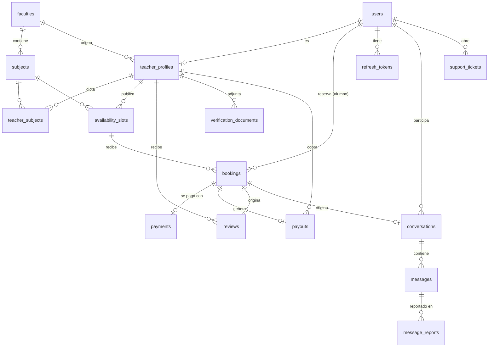

# Modelo de datos

Fuente de verdad: [`apps/api/prisma/schema.prisma`](../apps/api/prisma/schema.prisma). Restricciones adicionales: [`apps/api/prisma/sql/001_constraints.sql`](../apps/api/prisma/sql/001_constraints.sql).

## Convenciones

- Tablas en `snake_case` plural; columnas en `camelCase` (por eso el SQL crudo usa comillas dobles).
- IDs UUID. Fechas `timestamptz` en UTC.
- **Dinero: enteros en centavos de ARS.** Nunca `float` ni `decimal` para importes.
- Los importes de una reserva (`amountCents`, `commissionBps`, `commissionCents`, `teacherNetCents`) se **congelan** al crearla: cambios posteriores de precio o comisión no afectan reservas existentes.

## Diagrama



Tablas independientes: `faqs`, `platform_settings`, `webhook_events`, `outbox_events`.

## Restricciones críticas (integridad en la base, no solo en el código)

| Regla | Mecanismo |
|---|---|
| Un profesor no puede tener dos slots abiertos solapados | `EXCLUDE USING gist` sobre `(teacherProfileId, tstzrange(startsAt, endsAt))` |
| Un alumno no puede tener dos reservas activas solapadas | `EXCLUDE USING gist` sobre `(studentId, tstzrange(startsAt, endsAt))` para estados `PENDING_PAYMENT`/`CONFIRMED` |
| Un alumno no reserva dos veces el mismo slot | Índice único parcial `(slotId, studentId)` |
| Clase individual ⇒ cupo 1; `max ≥ min ≥ 1` | `CHECK` en `availability_slots` |
| `commissionCents + teacherNetCents = amountCents` | `CHECK` en `bookings` |
| Puntaje entre 1 y 5; una reseña por reserva | `CHECK` + `UNIQUE(bookingId)` |
| Webhook procesado una sola vez | `UNIQUE(provider, eventKey)` en `webhook_events` |

## Control de cupo en clases grupales

La base no puede contar cupos por sí sola. Al reservar se hace, dentro de **una transacción**:

1. `SELECT … FROM availability_slots WHERE id = $1 FOR UPDATE` (bloquea el slot).
2. Contar reservas activas del slot. Si `count >= maxStudents` ⇒ error `SLOT_UNAVAILABLE`.
3. Insertar la reserva en `PENDING_PAYMENT` con `holdExpiresAt = now() + 10 min`.

Una reserva `PENDING_PAYMENT` vencida pasa a `EXPIRED` por el job `bookings.expire` y libera el cupo.

## Estados

- **Reserva:** `PENDING_PAYMENT → CONFIRMED → COMPLETED`; también `CANCELLED` (desde cualquiera previa) y `EXPIRED` (solo desde `PENDING_PAYMENT`).
- **Profesor:** `PENDING → APPROVED | REJECTED`; `APPROVED ↔ SUSPENDED`.
- **Mensaje:** `VISIBLE | FLAGGED` (visible pero revisable) `| BLOCKED` (no se entrega).

## Configuración editable (`platform_settings`)

| Clave | Valor (JSON) | Ejemplo |
|---|---|---|
| `pricing.individual` | `{ "minCents": n, "maxCents": n }` | rango por hora, clase individual |
| `pricing.group` | `{ "minCents": n, "maxCents": n }` | rango por hora **por alumno**, clase grupal |
| `booking.holdMinutes` | `n` | 10 |
| `payout.releaseDelayHours` | `n` | 24 |

Los valores concretos del rango de precios **están por definir** (ver ARCHITECTURE §12).

## Migraciones

Ver [CONTRIBUTING.md](../CONTRIBUTING.md#migraciones-de-base-de-datos). Procedimiento de la migración inicial en el [README](../README.md#cómo-levantar-el-entorno-local).

| Migración | Fecha | Contenido |
|---|---|---|
| `init` | 2026-11-17 | Todas las tablas del esquema + restricciones de `sql/001_constraints.sql` (EXCLUDE, CHECK, índices parciales) |

**Verificar que las restricciones quedaron aplicadas:**

```bash
docker exec estudioya-postgres psql -U estudioya -d estudioya -c "\d bookings"
```

Debe listar `bookings_no_student_overlap` (EXCLUDE) y `bookings_amounts` (CHECK).

**Regla importante:** una migración ya aplicada **no se edita**. Si Prisma dice *"The migration was modified after it was applied"*, solo en desarrollo se arregla con `npx dotenv -e ../../.env -- prisma migrate reset` (ejecutado dentro de `apps/api`), que **borra todos los datos** de la base local. Nunca en producción.
