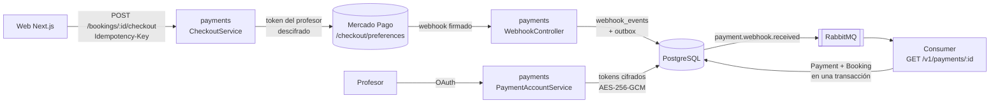
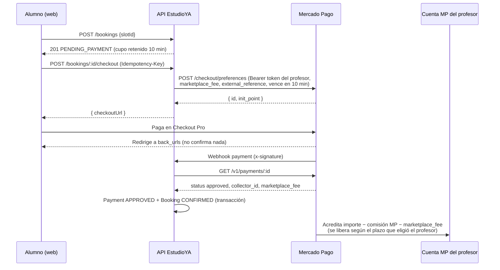
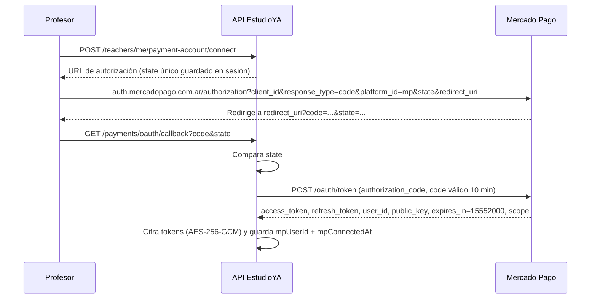
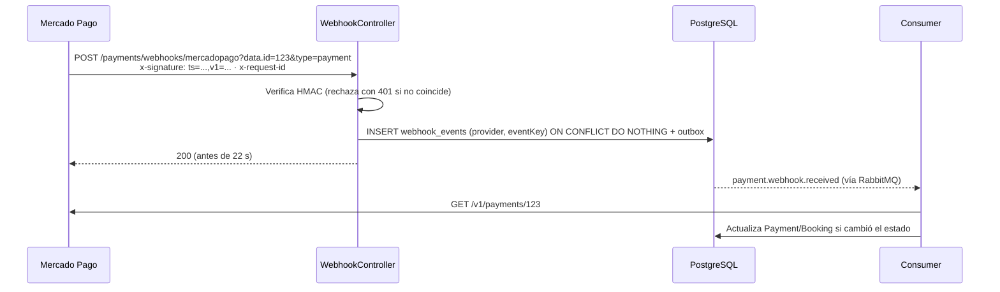

# ADR 0002: Pagos con Mercado Pago (spike BE-07)

- **Estado:** Propuesta. La prueba en el entorno de pruebas de Mercado Pago **se ejecutó el 2026-11-26 y funcionó** (§9.4 y §9.5). Falta la aprobación del equipo de los cambios de reglas de la §14.
- **Fecha:** 2026-11-24 · actualizado 2026-11-26 con los resultados del sandbox
- **Tarea:** BE-07 · Spike de pagos (desbloquea BE-08)
- **Relacionado:** [ADR 0001](0001-arquitectura-y-stack.md), [ARCHITECTURE §5 (BR-01, BR-06, BR-12, BR-13), §6 reglas 19–21, §9, §12 (R-01)](../ARCHITECTURE.md), [DATABASE](../DATABASE.md)

> **Cómo leer este documento.** Cada afirmación sobre Mercado Pago indica su fuente (§4). Se distinguen tres niveles:
> **[Doc]** lo dice la documentación oficial · **[Probado]** se ejecutó en este spike · **[A validar]** inferencia o dato no confirmado que hay que probar en sandbox o consultar a Mercado Pago.
> Nada de lo marcado **[A validar]** debe tomarse como cierto al implementar BE-08.

---

## 1. Contexto y problema

EstudioYA cobra clases particulares: el alumno paga dentro de la app, la plataforma retiene una comisión del 35 % y el resto es del profesor. El diseño inicial ([ADR 0001](0001-arquitectura-y-stack.md)) eligió Mercado Pago Marketplace (split de pagos) y dejó abierto el **riesgo R-01**: no estaba confirmado que se pueda **retener el dinero hasta que se dicte la clase**. Las reglas BR-12 (liberar el pago 24 h después de la clase) y BR-13 (reembolsos según la cancelación) dependen de eso.

Este spike responde: ¿qué permite realmente Mercado Pago en Argentina?, ¿se puede cumplir R-01?, y si no, ¿qué alternativa conviene?

## 2. Requisitos del negocio

| # | Requisito | Origen |
|---|---|---|
| RN-1 | Cobrar al alumno al reservar (cupo retenido 10 min mientras paga) | BR-06 |
| RN-2 | Comisión de la plataforma: 35 % del importe (`splitAmount()` en `packages/shared`) | BR-01 |
| RN-3 | El profesor recibe el resto | BR-01 |
| RN-4 | Retener el dinero hasta que se dicte la clase y liberarlo después (24 h sin reclamo) | BR-12, R-01 |
| RN-5 | Reembolsos según quién cancela y cuándo | BR-13 |
| RN-6 | Pagos idempotentes; webhooks firmados e idempotentes | §6 reglas 19–20 |
| RN-7 | Tokens de Mercado Pago de los profesores cifrados | §11 |
| RN-8 | Solo pueden cobrar profesores con cuenta de Mercado Pago vinculada | BR-11 |

## 3. Investigación realizada

1. Lectura de la documentación oficial de Mercado Pago Developers (sitio de Argentina) sobre Split de Pagos 1:1, OAuth, reserva/captura, webhooks, credenciales, cuentas y compras de prueba (§4).
2. Lectura de las condiciones comerciales públicas del checkout para vendedores argentinos (plazos de liberación).
3. Búsqueda de normativa del BCRA sobre proveedores de servicios de pago (solo como orientación para la consulta legal, §13).
4. **Prueba técnica** en `apps/api/scripts/mp-spike/` (§9): cliente OAuth, cifrado de tokens, preferencia con `marketplace_fee`, consulta de pagos y verificación de firmas de webhooks.
5. **Pruebas ejecutadas** (§9.4): 14 pruebas sin conexión de la lógica propia y un sondeo de los endpoints reales sin credenciales.
6. **Prueba contra el sandbox (2026-11-26)** (§9.4 y §9.5): OAuth de un vendedor de prueba, preferencia con `marketplace_fee`, pago con tarjeta aprobado con la comisión aplicada y webhook real con firma válida. Para llegar a eso hubo que corregir cómo se crea la aplicación y cómo se pide el token (§9.5).

## 4. Documentación oficial consultada

Leídas (HTTP 200):

| Tema | URL |
|---|---|
| Split 1:1 · requisitos previos | https://www.mercadopago.com.ar/developers/es/docs/split-payments/split-1-1/prerequisites |
| Split 1:1 · integrar el checkout (Checkout Pro / API) | https://www.mercadopago.com.ar/developers/es/docs/split-payments/split-1-1/integration-configuration/integrate-marketplace |
| Split · crear configuración (aplicación marketplace, OAuth) | https://www.mercadopago.com.ar/developers/es/docs/split-payments/integration-configuration/create-configuration |
| Checkout Pro en marketplace | https://www.mercadopago.com.ar/developers/es/docs/checkout-pro/how-tos/integrate-marketplace |
| OAuth · obtener access token | https://www.mercadopago.com.ar/developers/es/docs/security/oauth/creation |
| OAuth · renovar access token | https://www.mercadopago.com.ar/developers/es/docs/security/oauth/renewal |
| Reservar fondos (Payments API, legacy) | https://www.mercadopago.com.ar/developers/es/docs/checkout-api-payments/payment-management/make-value-reserve |
| Reservar, capturar y cancelar (Orders API) | https://www.mercadopago.com.ar/developers/es/docs/checkout-api-orders/payment-management/reserve-capture-cancel |
| Webhooks | https://www.mercadopago.com.ar/developers/es/docs/your-integrations/notifications/webhooks |
| Validar el origen de la notificación (plantilla de firma) | https://www.mercadopago.com.ar/developers/en/docs/wallet-connect/notifications |
| Credenciales | https://www.mercadopago.com.ar/developers/es/docs/your-integrations/credentials |
| Cuentas de prueba | https://www.mercadopago.com.ar/developers/es/docs/your-integrations/test/accounts |
| Compras de prueba (tarjetas y estados) | https://www.mercadopago.com.ar/developers/es/docs/checkout-pro/integration-test/test-purchases |
| Condiciones del checkout para vendedores | https://www.mercadopago.com.ar/herramientas-para-vender/check-out |

No disponibles al momento del spike (no se usó nada de ellas): la referencia de **Advanced Payments** (`/reference/advanced_payments/...`, HTTP 404), la referencia de `GET /v1/payments/{id}` (HTTP 404 en la URL probada) y las páginas de ayuda `ayuda/cuando-podre-usar-dinero_275` y `ayuda/26748` (HTTP 403).

Normativa (orientativa, §13): BCRA Comunicación "A" 6885 (https://www.bcra.gob.ar/archivos/Pdfs/comytexord/A6885.pdf) y texto ordenado de PSP (https://www.bcra.gob.ar/archivos/Pdfs/Texord/t-snp-psp.pdf).

## 5. Hallazgos: qué permite Mercado Pago

Se separan los conceptos que el pedido del spike exige no mezclar.

### 5.1 División del pago (split) y comisión de la plataforma

- **[Doc]** El modelo general es **Split de Pagos 1:1** (un vendedor por pago). El **1:N** (varios vendedores) está "disponible únicamente para vendedores de cartera asesorada", es decir, con acuerdo comercial con Mercado Pago.
- **[Doc]** La comisión de la plataforma se envía como **monto** (no porcentaje):
  - Checkout Pro → `marketplace_fee` en `POST /checkout/preferences`.
  - Checkout API (Payments) → `application_fee` en `POST /v1/payments`.
  - El Split 1:1 se integra "sólo" con Checkout Pro, Checkout API y Checkout Bricks. La Orders API no aparece en la guía de split.
- **[Doc]** El pago se crea **con el access token del vendedor** (el profesor), obtenido por OAuth. El `user_id` del token es el `collector_id` del pago. La aplicación de la plataforma es la que recibe la comisión.
- **[Doc + Probado]** Orden de descuentos: "primero se descuenta la comisión de Mercado Pago, y la comisión del marketplace se descuenta del saldo restante". **Consecuencia:** con `marketplace_fee` = 35 % del precio, el profesor recibe **65 % menos la comisión de Mercado Pago**, no el 65 % que dice hoy BR-01 (ver §14, decisión D-08). En sandbox, sobre $15.000: comisión de Mercado Pago $615, comisión de la plataforma $5.250, **neto del profesor $9.135**; las dos figuran en `fee_details` con `fee_payer: collector` (§9.4).
- **[Doc]** Requisitos del vendedor: cuenta de Mercado Pago de vendedor con nivel de identificación **KYC 6** y autorizar a la aplicación por OAuth. La aplicación se crea como "Pagos online" → Checkout Pro o Checkout API → modelo **Marketplace**.
- **[Probado]** En el panel actual no aparece la opción "modelo Marketplace" al crear la aplicación. Lo que hizo funcionar el split fue crear la aplicación **desde una cuenta con perfil Marketplace** (en pruebas, una cuenta de prueba de tipo "Marketplace") y con **Checkout Pro + API de Preferences**. Con eso la preferencia devuelve `marketplace: "MP-MKT-<id de la aplicación>"`; con una aplicación creada desde una cuenta común devuelve `marketplace: "NONE"` y todos los pagos al vendedor se rechazan (§9.5).
- **[Probado]** El alumno **puede pagar con tarjeta de crédito** en split: pago aprobado con Mastercard de prueba. La frase de la guía sobre "dinero en cuenta" no impide pagar con tarjeta. Débito y otros medios no se probaron.

### 5.2 Autorización y captura (reserva de fondos)

- **[Doc]** Payments API (marcada *legacy* en la navegación): `POST /v1/payments` con `capture: false` devuelve `status: authorized`, `status_detail: pending_capture`. "La reserva tendrá una validez de 7 días"; si no se captura, se cancela.
- **[Doc]** Orders API: `capture_mode: manual`, captura con `POST /v1/orders/{id}/capture` (solo el monto total); plazo de **5 días**.
- **[Doc]** Los ejemplos usan tarjeta de crédito. **[A validar]** qué medios la admiten (débito, dinero en cuenta), si funciona en Checkout Pro (la documentación la ubica solo en Checkout API y Bricks) y **si se puede combinar con `application_fee`** (las páginas de reserva no lo mencionan).
- **Conclusión:** la reserva solo cubre clases que empiezan dentro de los 5–7 días siguientes al pago. No sirve como mecanismo general de retención.

### 5.3 Retención y liberación del dinero al vendedor

- **[Doc]** Las páginas de split no ofrecen ningún parámetro para que el integrador elija **cuándo** se libera el dinero al vendedor. Lo único que mencionan es configurar la fecha de liberación **de la comisión** del marketplace, y para eso hay que contactar "a tu ejecutivo comercial de cartera asesorada".
- **[Doc]** Para cobros online, el vendedor elige en su propia cuenta cuándo recibe el dinero: "al instante, en 10, 18 o 35 días corridos", y "cuanto antes lo recibas, mayor será el costo de procesamiento" (condiciones públicas del checkout; tasas publicadas a la fecha: 6,29 %, 4,39 %, 3,39 % y 1,49 % + IVA respectivamente, variables por provincia).
- **[Probado]** El pago expone `money_release_date` y `money_release_status`. En sandbox: pago del 2026-11-26, liberación el 2026-12-14 (18 días), estado `pending`. Sirve para **informar** al profesor, no para fijarla.
- **[No verificado]** Existe una API "Advanced Payments" con `disbursements` y `money_release_days` por vendedor, que permitiría diferir la liberación. Su documentación devolvió 404 durante el spike y una búsqueda la describe como *legacy*. **No se tomó como opción viable sin confirmación de Mercado Pago.**

### 5.4 Reembolsos y contracargos

- **[Doc]** En 1:1 el reembolso se descuenta **proporcionalmente** de la cuenta del vendedor y de la del marketplace.
- **[Doc]** "El Marketplace no podrá realizar el reembolso total si el vendedor no tuviera dinero en la cuenta." En ese caso la plataforma devuelve su parte y decide si cubre el resto "por otro medio".
- **[A validar]** Qué token se usa para reembolsar (el del vendedor o el de la plataforma) y cómo se reparte un **contracargo**: las páginas consultadas no lo detallan.

### 5.5 Credenciales y entorno de pruebas

- **[Doc]** Credenciales de una aplicación: **Public Key** (frontend), **Access Token** (backend, nunca en el frontend), **Client ID** y **Client Secret** (OAuth). Las de prueba se crean con la aplicación y su access token empieza con `APP_USR` (no `TEST-`). Las de producción requieren "activar el entorno de producción" (rubro, sitio web, términos).
- **[Doc]** Cuentas de prueba: hasta **15** por aplicación, se crean en *Tus integraciones → Cuentas de prueba*. El país se elige al crearlas y no se puede cambiar. Vendedor y comprador deben ser **del mismo país**; en marketplace se puede usar además una cuenta que represente al integrador.
- **[Probado]** Hay tres tipos de cuenta de prueba: **Comprador**, **Vendedor** y **Marketplace** ("para simular a los intermediarios en pruebas con Split de Pagos"). Las cuentas de prueba **no se pueden borrar**. En una aplicación que pertenece a una cuenta de prueba, el panel muestra un solo juego de credenciales (Public Key y Access Token `APP_USR`) y el Client Secret aparece en otra sección del menú de la aplicación.
- **[Probado]** El panel avisa que la **API de Preferences "será descontinuada pronto"**. Hoy es la única con la que funcionó el split en Checkout Pro (la Orders API no aparece en la guía de split). **Riesgo para BE-08:** seguir los anuncios de Mercado Pago y planificar la migración cuando la Orders API soporte split.

## 6. Arquitectura propuesta (para BE-08)

Respeta el monolito modular, el patrón outbox y las reglas de contrato existentes. **No se implementa en este spike.**



| Pieza | Responsabilidad | Reutiliza |
|---|---|---|
| `PaymentAccountService` | URL de OAuth con `state` (y PKCE si se activa), callback `GET /payments/oauth/callback`, guardado cifrado en `teacher_profiles.mp*`, renovación antes del vencimiento (180 días) | `mpUserId`, `mpAccessTokenEnc`, `mpRefreshTokenEnc` y `mpConnectedAt` ya existen en el esquema; `TOKEN_ENCRYPTION_KEY` ya está en `.env.example` |
| `CheckoutService` | `POST /bookings/:id/checkout`: crea la preferencia con el token del profesor, `marketplace_fee = booking.commissionCents / 100` (importe **congelado** en la reserva), `external_reference = bookingId`, vencimiento = `holdExpiresAt`, header `X-Idempotency-Key` | `Booking.amountCents/commissionCents` (DATABASE.md), `splitAmount()`, regla 19 |
| `WebhookController` | `POST /payments/webhooks/mercadopago`: verifica la firma, inserta en `webhook_events (provider, eventKey)` (único), escribe el outbox y responde 200 de inmediato | Excepción CSRF ya prevista en `csrf-header.middleware.ts`; tabla `WebhookEvent` |
| Consumer `payments.webhook` | Consulta `GET /v1/payments/{id}` con el token del profesor (identificado por `collector_id` = `mpUserId`), actualiza `payments` y `bookings` en una transacción, y es idempotente | ARCHITECTURE §9 |
| Reembolsos | `POST /v1/payments/{id}/refunds` según BR-13 **[A validar]** | — |

Variable nueva necesaria en BE-08 **[propuesta]**: `API_PUBLIC_URL` (URL pública HTTPS de la API, para `notification_url`). En desarrollo hace falta un túnel (por ejemplo cloudflared o ngrok), porque Mercado Pago no puede llamar a `localhost`.

## 7. Flujo de pagos (opción recomendada A, §12)



Estados de pago a manejar **[A validar: la referencia de `GET /v1/payments/{id}` no estaba disponible; `authorized` sí está documentado en la página de reservas]**: `pending`, `in_process`, `authorized`, `approved`, `rejected`, `cancelled`, `refunded`, `charged_back`, `in_mediation`. La reserva pasa a `CONFIRMED` **solo** con `approved` consultado a la API, nunca por la redirección del navegador ni por el cuerpo del webhook.

## 8. Flujos de OAuth y de webhooks

### 8.1 OAuth del profesor



- **[Doc]** El `redirect_uri` debe coincidir **exactamente** con el configurado en la aplicación; los datos variables van en `state`.
- **[Probado]** El panel **no acepta `localhost`** como Redirect URL, ni con `http` ni con `https` ("Revisá la URL que ingresaste"). En desarrollo hace falta una URL pública HTTPS: se usó un dominio fijo gratuito de ngrok que apunta a `localhost:4000` (§9.2).
- **[Probado]** **No usar `test_token=true`** al canjear el code. Con ese parámetro el token sale `TEST-…` y el checkout de las preferencias creadas con él falla ("Tuvimos un problema"). Sin el parámetro el token sale `APP_USR-…` y funciona.
- **[Probado]** El code de autorización incluye el `user_id` de quien autorizó al final (`TG-…-<user_id>`). En el callback de BE-08 conviene compararlo con el `user_id` de la respuesta de `/oauth/token`, y en pruebas sirve para detectar que se autorizó con la cuenta equivocada.
- **[Probado]** El access token dura **180 días** (`expires_in` 15552000) y el `scope` devuelto incluye `offline_access`. La renovación usa `grant_type=refresh_token`, solo funciona si el `scope` incluye `offline_access`, y **el refresh token también se renueva**: hay que guardar siempre el par nuevo.
- **[Doc]** PKCE es opcional. Si se activa en la aplicación pasa a ser obligatorio (`code_challenge`, `code_challenge_method` S256 y `code_verifier`).
- **[Doc]** La URL de autorización aparece con host `.com.ar` en la guía de split y `.com` en la guía general de OAuth. El spike usa `.com.ar` **[A validar]**.
- **[Probado]** `POST https://api.mercadopago.com/oauth/token` acepta cuerpo JSON (con credenciales falsas responde `400 invalid_client`, no un error de formato).
- **Propuesta:** un job diario renueva los tokens que vencen en menos de 30 días. Si la renovación falla, el profesor queda "sin cuenta vinculada" y no se le pueden crear checkouts (BR-11).

### 8.2 Webhooks



- **[Doc]** Configuración en *Tus integraciones → Webhooks* (URLs distintas para pruebas y producción) o por pago/preferencia (`notification_url`, que tiene prioridad). Tópico **`payment`** para Checkout Pro / Checkout API.
- **[Doc]** Responder 200 o 201 en menos de **22 segundos**. Si no, Mercado Pago reintenta cada 15 minutos y, después del tercer intento, sigue enviando con un plazo más largo. Por eso hay que responder rápido y procesar en segundo plano (§9 de ARCHITECTURE).
- **[Doc]** El cuerpo trae solo el ID (`type`, `action`, `data.id`, `live_mode`, `user_id`…): **siempre** se consulta el pago.
- **[Doc]** Firma: `x-signature: ts=<ms>,v1=<hmac>`. Se calcula HMAC-SHA256 en hexadecimal, con la clave secreta de *Tus integraciones* como llave, sobre la plantilla `id:[data.id];request-id:[x-request-id];ts:[ts];`. `data.id` sale del **query string** y, si es alfanumérico, va **en minúsculas**. La clave no vence y se puede regenerar.
- **[Probado]** La plantilla `id:[data.id];request-id:[x-request-id];ts:[ts];` **verifica** con webhooks reales de `payment` (dos pagos, dos aplicaciones distintas, `valid: true`).
- **[Probado]** Las notificaciones de pagos creados con el token del profesor llegan a la `notification_url` de la preferencia, firmadas con la clave secreta **de la aplicación de la plataforma**. El cuerpo trae `user_id` = el profesor (`collector_id`) y `live_mode: true` aun en pruebas.
- **[Probado]** Además del tópico `payment` llegan notificaciones `merchant_order` (con `?id=&topic=merchant_order` en la URL y cuerpo `{resource, topic}`), incluso para intentos de pago rechazados. El controller de BE-08 debe ignorarlas o registrarlas sin procesarlas.
- **[A validar]** Si falta un valor, el spike omite su segmento (comportamiento usado por implementaciones de la comunidad). Los ejemplos oficiales usan cadena vacía. No se dio el caso en las pruebas.
- **Idempotencia:** `webhook_events` ya tiene la clave única `(provider, eventKey)`. Como el consumer siempre relee el estado real del pago, procesar dos veces el mismo evento no cambia el resultado. `eventKey` = ID de la notificación **[A validar que los reintentos mantienen el ID]**.
- **Decisión propia:** comparación en tiempo constante (`timingSafeEqual`) y ventana opcional de antigüedad del `ts`. La documentación no define ventana, así que en el spike está desactivada por defecto.

## 9. Ejemplo de código contra el entorno de pruebas

### 9.1 Archivos

| Archivo | Qué hace |
|---|---|
| `apps/api/scripts/mp-spike/mercadopago.ts` | Funciones reutilizables en BE-08: URL de OAuth y PKCE, canje y renovación de tokens, cifrado AES-256-GCM, cuerpo de la preferencia con `marketplace_fee` (usa `splitAmount()` de shared), creación de la preferencia, consulta de pagos y verificación de firma de webhooks |
| `apps/api/scripts/mp-spike/cli.ts` | CLI para ejecutar cada paso contra el sandbox. Nunca imprime tokens: los guarda cifrados en `apps/api/storage/mp-spike/` (ignorada por git) |
| `apps/api/scripts/mp-spike/selftest.ts` | 14 pruebas sin conexión con vectores independientes (openssl, RFC 7636) |
| `apps/api/scripts/mp-spike/tsconfig.json` | Typecheck de los scripts (fuera de `src/`: no entran en el build de la API) |

Sin dependencias nuevas: `fetch` nativo y `node:crypto`. Comandos en `apps/api/package.json`: `spike:mp`, `spike:mp:selftest` y `spike:mp:typecheck`.

### 9.2 Preparación (la hace una persona del equipo, una sola vez)

Pasos que funcionaron el 2026-11-26. El orden importa: la aplicación tiene que pertenecer a la cuenta Marketplace (§9.5).

1. **URL pública para OAuth y webhooks.** Mercado Pago no acepta `localhost`. Crear una cuenta gratuita de [ngrok](https://ngrok.com) (en Windows se instala con `winget install Ngrok.Ngrok`), configurar el authtoken (`ngrok config add-authtoken <token>`) y anotar el **dominio fijo gratuito** que aparece en *Domains* (`<algo>.ngrok-free.dev`). Para levantar el túnel: `ngrok http 4000 --url=https://<dominio>`.
2. Con tu cuenta real de Mercado Pago, en *Tus integraciones → Cuentas de prueba*, crear **todas de Argentina**:
   - una cuenta **Marketplace** (hace de plataforma y es la dueña de la aplicación);
   - una cuenta **Vendedor** (hace de profesor);
   - una cuenta **Comprador** (hace de alumno).
3. Cerrar sesión e **ingresar con la cuenta Marketplace** a https://www.mercadopago.com.ar/developers/panel/app. Crear la aplicación: *Crear en el panel de integración* → **Checkout Pro** → *Tipo de API*: **API de Preferences**.
4. En *Configurar aplicación → Configuración avanzada*: Redirect URL `https://<dominio>/api/v1/payments/oauth/callback`, PKCE **No**, permisos lectura, acceso offline y escritura. Guardar (pide reCAPTCHA).
5. En *Webhooks* (modo de prueba): URL `https://<dominio>/api/v1/payments/webhooks/mercadopago` y eventos **Pagos**, **Vinculación de aplicaciones**, **Contracargos** y **Split - Autorización**. Al guardar se genera la clave secreta.
6. Copiar al `.env` de la raíz (**nunca** al repositorio):
   - N.º de aplicación → `MP_APP_ID`; Client Secret → `MP_CLIENT_SECRET`;
   - Access Token (`APP_USR-…`) → `MP_PLATFORM_ACCESS_TOKEN`; clave secreta de Webhooks → `MP_WEBHOOK_SECRET`;
   - `MP_OAUTH_REDIRECT_URL` con el dominio de ngrok.
7. Generar la clave de cifrado: `npm run spike:mp -w @estudioya/api -- gen-key` → `TOKEN_ENCRYPTION_KEY`.

### 9.3 Ejecución

```bash
npm run build:shared
npm run spike:mp:selftest -w @estudioya/api              # 1. lógica propia, sin conexión
npm run spike:mp -w @estudioya/api -- oauth-url          # 2. abrir la URL con el VENDEDOR de prueba (incógnito, ver nota)
npm run spike:mp -w @estudioya/api -- oauth-exchange <code>          # 3. antes de 10 min. SIN --test (§8.1)
npm run spike:mp -w @estudioya/api -- preference --amount 1500000 --notification-url https://<dominio>/api/v1/payments/webhooks/mercadopago
#   4. preferencia de $15.000 con marketplace_fee $5.250. Verificar que la salida diga marketplace: "MP-MKT-…" (no "NONE").
#   5. Abrir el init_point (www.mercadopago.com.ar, NO sandbox.) con el COMPRADOR de prueba y pagar con tarjeta de prueba.
#      Nombre del titular APRO = aprobado, OTHE = rechazado, CONT = pendiente.
#      Tarjetas: ver "Compras de prueba" en la documentación oficial (§4) o el panel de la aplicación.
npm run spike:mp -w @estudioya/api -- payment <paymentId>            # 6. estado, fee_details, neto, money_release_date
npm run spike:mp -w @estudioya/api -- verify-webhook --x-signature "<header>" --x-request-id "<header>" --data-id <id>   # 7.
npm run spike:mp -w @estudioya/api -- oauth-refresh                  # 8. renovar y comprobar que el refresh token rota
```

Para el paso 7 hace falta recibir un webhook real: un receptor HTTP en el puerto 4000 que registre query, headers y cuerpo, expuesto con el túnel de ngrok (§9.2).

**Nota sobre las sesiones de prueba.** En Chrome todas las ventanas de incógnito comparten la sesión, así que es fácil autorizar o pagar con la cuenta equivocada. Antes de cambiar de cuenta de prueba hay que cerrar **todas** las ventanas de incógnito. El code de OAuth termina en el `user_id` de quien autorizó: si no es el del vendedor, no canjearlo.

**Pendiente de registrar** (no se ejecutó todavía): `oauth-refresh` (rotación del refresh token) y reembolso total y parcial (agregar el comando cuando se valide el endpoint).

### 9.4 Resultados

| Prueba | Resultado |
|---|---|
| `spike:mp:typecheck` (TypeScript estricto) | ✅ Sin errores |
| `spike:mp:selftest` | ✅ 14/14. Comisión 35 % como monto y redondeo half-up (BR-01), pesos/centavos, vencimiento de la preferencia, PKCE S256 (vector del RFC 7636), URL de OAuth, AES-256-GCM (ida y vuelta, IV distinto, detecta alteraciones y clave incorrecta), firma de webhooks (vectores calculados con `openssl`, minúsculas, segmento omitido, rechazos y ventana de antigüedad) |
| CLI sin credenciales | ✅ Falla con un mensaje claro ("Falta MP_APP_ID…") y no llama a Mercado Pago |
| Sondeo de endpoints reales sin credenciales | ✅ `POST /oauth/token` → `400 invalid_client`; `GET /v1/payments/1` → `401 unauthorized`; `POST /checkout/preferences` → `403` (política de autorización) |
| `npm run typecheck -w @estudioya/api` | ✅ La API no se ve afectada |
| OAuth real con vendedor de prueba (2026-11-26) | ✅ Token `APP_USR-…` del vendedor, 180 días, `scope` con `offline_access`, guardado cifrado. Con `--test` (`test_token=true`) el token sale `TEST-…` y no sirve para cobrar (§9.5) |
| Pago con tarjeta **sin** split (cuenta dueña de la aplicación) | ✅ Pago 191797311422 · `approved`/`accredited` · $15.000 · Mastercard crédito · comisión de Mercado Pago $615 · neto $14.385 · liberación a los 18 días |
| Preferencia con `marketplace_fee` y pago de prueba con tarjeta | ✅ Pago 190699902431 · `approved`/`accredited` · $15.000 · Mastercard crédito · `fee_details`: `mercadopago_fee` $615 y `application_fee` $5.250, ambas `fee_payer: collector` · **neto del profesor $9.135** · `money_release_date` 2026-12-14 (18 días) · aplicación creada desde una cuenta Marketplace (§9.5) |
| Webhook real y validación de firma | ✅ Llegó por el túnel con `type=payment`; `verify-webhook` → `valid: true` en los dos pagos |
| Renovación del token (`oauth-refresh`) | ⛔ No ejecutado |
| Reembolso total y parcial | ⛔ No ejecutado (falta el comando) |
| Reserva/captura con `application_fee` | ⛔ **No ejecutado**. Requiere Checkout API/Bricks; queda como prueba de la opción B |

### 9.5 Problemas encontrados en el sandbox y cómo se resolvieron

| Síntoma | Causa | Solución |
|---|---|---|
| El panel rechaza `http://localhost…` y `https://localhost…` como Redirect URL | Mercado Pago exige una URL pública | Dominio fijo de ngrok (§9.2, paso 1) |
| El checkout muestra "Tuvimos un problema" | Token del vendedor pedido con `test_token=true` (`TEST-…`) y link `sandbox_init_point` | Canjear el code sin `--test` y usar `init_point` |
| El pago se rechaza con "No pudimos procesar tu pago", **incluso sin `marketplace_fee`**; no se crea ningún pago, solo una `merchant_order` en `payment_required` | La aplicación se había creado desde una cuenta común (no Marketplace) y con API de Orders; la preferencia devolvía `marketplace: "NONE"` | Crear la aplicación **desde una cuenta de prueba Marketplace** con Checkout Pro + API de Preferences. La preferencia pasa a devolver `marketplace: "MP-MKT-<app>"` y el pago se aprueba |
| El code de OAuth es de la cuenta equivocada | Las ventanas de incógnito de Chrome comparten la sesión | Cerrar todas las ventanas de incógnito antes de cambiar de cuenta y revisar el `user_id` al final del code |

**Pendiente para producción [A validar]:** el equivalente real de la "cuenta Marketplace" de pruebas. Hay que confirmar con Mercado Pago qué tiene que tener la cuenta de EstudioYA para que su aplicación opere como marketplace (perfil, habilitación comercial o solo crear la aplicación desde esa cuenta).

## 10. Limitaciones encontradas

1. **No hay retención controlada por la plataforma en Split 1:1** (§5.3). El dinero del profesor se libera según el plazo que **él** eligió en su cuenta.
2. **La comisión de Mercado Pago la absorbe el profesor**: se descuenta antes de `marketplace_fee`, y su porcentaje depende del plazo de liberación del profesor, que la plataforma no conoce al crear la preferencia.
3. **Reembolsos limitados por el saldo del profesor** (§5.4).
4. **La reserva/captura dura 5–7 días**, se probó solo con crédito en la documentación y no está documentada junto con el split.
5. **Todos los profesores necesitan cuenta de vendedor de Mercado Pago con KYC 6.** Es una barrera de alta para estudiantes.
6. ~~Duda abierta sobre los medios de pago admitidos en split~~ **Resuelta:** se puede pagar con tarjeta de crédito (§5.1). Otros medios no se probaron.
7. Webhooks y OAuth: Mercado Pago no puede notificar a `localhost` ni acepta `localhost` como Redirect URL. En desarrollo hace falta un túnel con dominio fijo.
8. La aplicación tiene que pertenecer a una cuenta con perfil Marketplace (§9.5), y la API de Preferences, la única con la que funcionó, está anunciada como "será descontinuada pronto" (§5.5).
9. Partes de la documentación son inconsistentes o no estaban disponibles (host de OAuth, Advanced Payments, referencia de `GET /payments`). El host `auth.mercadopago.com.ar` funcionó en las pruebas.

## 11. Análisis del riesgo R-01

**Pregunta:** ¿Mercado Pago (Marketplace/Split) permite retener el dinero hasta que se dicte la clase y liberarlo después?

**Respuesta: no con lo que está documentado para integración autónoma.**

| Mecanismo | ¿Resuelve R-01? | Evidencia |
|---|---|---|
| Split 1:1 (`marketplace_fee`/`application_fee`) | ❌ Divide el pago, pero no define cuándo se libera | [Doc] sin parámetro de fecha. La liberación depende del plazo del vendedor |
| Configurar la fecha de liberación | ❌ Solo de la **comisión**, y vía ejecutivo comercial | [Doc] requisitos previos de split |
| Reserva y captura | ⚠ Parcial: solo clases dentro de 5–7 días, tarjeta, sin confirmar con split | [Doc] páginas de reserva |
| Split 1:N / Advanced Payments (`money_release_days`) | ❓ Posible, pero requiere "cartera asesorada" y no se pudo verificar | [Doc] 1:N restringido; Advanced Payments sin documentación accesible |
| Plazo de liberación largo del profesor (35 días) | ❌ Lo decide el profesor, no la plataforma | [Doc] condiciones del checkout |

**Impacto si se acepta el riesgo** (opción A): si el profesor no dicta la clase, el reembolso depende de que tenga saldo. Si no lo tiene, la plataforma solo puede devolver su 35 % y el resto queda como deuda del profesor. **Mitigaciones propuestas:** reputación y suspensión (BR-11 + admin), política de cancelación clara (BR-13), soporte (tickets ya existentes), y que el alumno confirme la clase para habilitar la reseña (BR-08).

## 12. Alternativas consideradas

| | A. Split 1:1 con Checkout Pro | B. Split 1:1 + reserva/captura (Checkout API/Bricks) | C. Cobro centralizado y pago posterior al profesor | D. Acuerdo comercial (1:N / Advanced Payments) |
|---|---|---|---|---|
| Cómo funciona | Preferencia con el token del profesor y `marketplace_fee` | Autorizar al reservar y capturar al dar la clase (o al vencer el plazo) | La plataforma cobra el 100 % en su cuenta y transfiere el 65 % después de la clase | Mercado Pago habilita liberar al vendedor en una fecha elegida |
| R-01 | ❌ No | ⚠ Solo clases a ≤ 5–7 días | ✅ Sí | ✅ Probablemente |
| Documentado para AR | ✅ | ⚠ Reserva sí; combinada con split, no | ✅ Checkout Pro común; el pago a profesores es otra integración **[A validar]** | ❓ Requiere ejecutivo comercial |
| Fondos de terceros en la plataforma | No | No | **Sí** | No (los retiene Mercado Pago) |
| Complejidad técnica | Baja | Media/alta (formulario de tarjeta con Bricks, jobs de captura) | Alta (conciliación, pagos salientes, contracargos a cargo de la plataforma) | Media, pero depende de un acuerdo |
| Riesgo legal/fiscal (§13) | Bajo | Bajo | **Alto** | Bajo/medio |
| Contracargos y reembolsos | Proporcionales; límite por saldo del profesor | Sin captura no hay cobro (anular la reserva no genera reembolso) | 100 % a cargo de la plataforma | Según el acuerdo |

## 13. Implicancias legales y fiscales (Argentina)

> **No es asesoramiento legal ni contable.** Son preguntas concretas para el contador y el abogado (decisiones D-05 y D-06 de ARCHITECTURE §12), con lo que se pudo averiguar.

**Opción A (split):**
- El profesor es quien vende el servicio y cobra en su cuenta; la plataforma cobra una **comisión** por intermediación. Preguntas al contador: cómo factura la plataforma la comisión (IVA si es responsable inscripta), y si el profesor debe estar inscripto (por ejemplo, en el monotributo) para recibir cobros y facturar al alumno.
- **[A validar]** Retenciones e impuestos que Mercado Pago puede aplicar a las cuentas de los vendedores según su situación fiscal y provincia.

**Opción C (cobro centralizado):**
- La plataforma recibiría y mantendría **fondos de terceros**. El BCRA regula a los **proveedores de servicios de pago** (Com. "A" 6859 y "A" 6885: los PSP que ofrecen cuentas de pago deben inscribirse en un registro y mantener los fondos de clientes disponibles). Pregunta al abogado: ¿cobrar en nombre de los profesores y liquidarles después encuadra en ese régimen o en otro?
- Riesgo de que el **100 % del cobro** se considere ingreso de la plataforma a efectos de IVA, Ingresos Brutos y Ganancias, salvo que se instrumente como cobro por cuenta y orden de terceros (mandato). Pregunta al contador.
- Contracargos y fraude: la plataforma responde por el total.

**Todas las opciones:**
- Defensa del Consumidor (Ley 24.240): derecho de revocación de servicios contratados a distancia y **botón de arrepentimiento**. Hay que compatibilizarlo con BR-13, sobre todo en clases que se dictan dentro del plazo de revocación.
- Datos personales (Ley 25.326): los datos de pago los maneja Mercado Pago. La plataforma guarda IDs, estados e importes, no datos de tarjetas.

## 14. Decisión y justificación

**Propuesta al equipo:**

1. **MVP con la opción A (Split 1:1 con Checkout Pro y `marketplace_fee`)**.
   - Es la única opción documentada de punta a punta para integración autónoma en Argentina.
   - No convierte a la plataforma en custodia de fondos de terceros, lo que evita el riesgo regulatorio de la opción C.
   - Usa el redirect de Checkout Pro, que encaja con el mockup de reserva ("paso a Mercado Pago") y deja los datos de tarjeta fuera de EstudioYA.
2. **Aceptar R-01 como riesgo residual** con las mitigaciones de §11 y **cambiar reglas** (requiere aprobación del equipo, D-02):
   - **BR-12** pasa de "se libera 24 h después de la clase" a "Mercado Pago acredita al profesor según el plazo de liberación elegido en su cuenta; EstudioYA no retiene fondos". La tabla `payouts` queda como registro informativo (`money_release_date`) o se elimina en BE-08.
   - **BR-13**: los reembolsos se hacen por la API de Mercado Pago. Si el profesor no tiene saldo, la plataforma devuelve su comisión y gestiona el resto (definir si la plataforma cubre la diferencia).
   - **D-08 (nueva) · BR-01**: el profesor recibe "65 % menos la comisión de Mercado Pago". Alternativa: bajar `marketplace_fee` para absorber la comisión de Mercado Pago, que es imposible de calcular con exactitud porque depende del plazo que eligió el profesor.
3. **En paralelo, sin bloquear el MVP:**
   - ~~Ejecutar §9.3 con credenciales de prueba y completar §9.4 (sobre todo el pago con tarjeta en split).~~ Hecho el 2026-11-26. Quedan `oauth-refresh` y reembolsos.
   - Probar la opción B (reserva con `application_fee`) para clases dentro de los 5–7 días.
   - **Contactar a Mercado Pago** (comercial) para preguntar por la liberación diferida (1:N, Advanced Payments o fecha de liberación configurable).
   - Consultar contador y abogado con las preguntas de §13.
4. **Descartar la opción C para el MVP** por el riesgo legal y fiscal. Se reevalúa si el abogado y el contador confirman que es viable.

**Resultado de la prueba en sandbox (2026-11-26):** el split **admite pago con tarjeta** y la comisión se aplica como se esperaba (§9.4), así que la opción A se mantiene. Lo que cambia para BE-08: la aplicación de producción tiene que crearse desde la cuenta de EstudioYA con perfil Marketplace (confirmar con Mercado Pago, §9.5), el canje de OAuth no usa `test_token`, los webhooks `merchant_order` se ignoran y hay que seguir el anuncio de baja de la API de Preferences.
